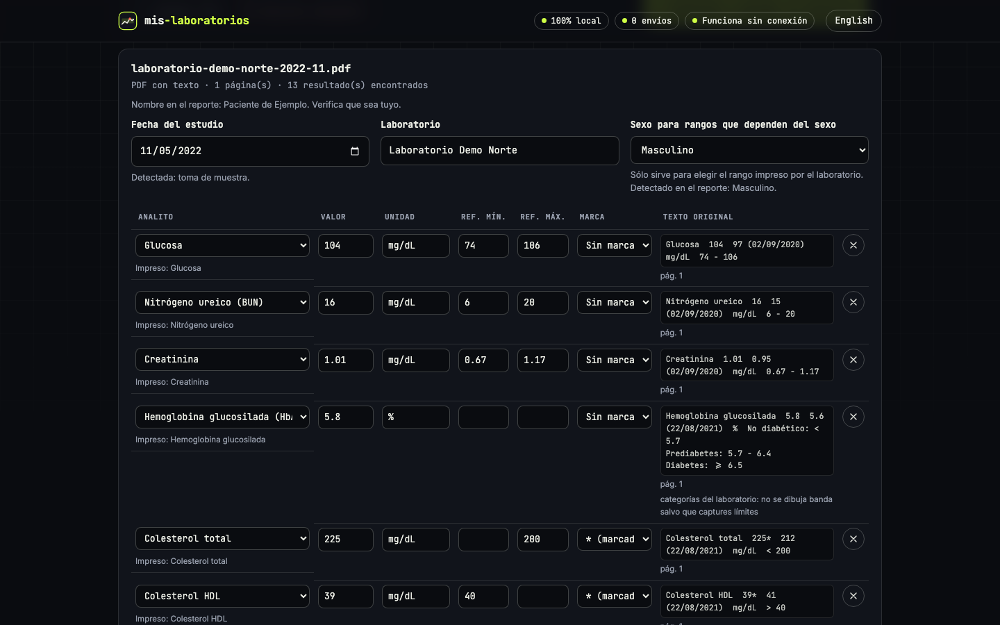
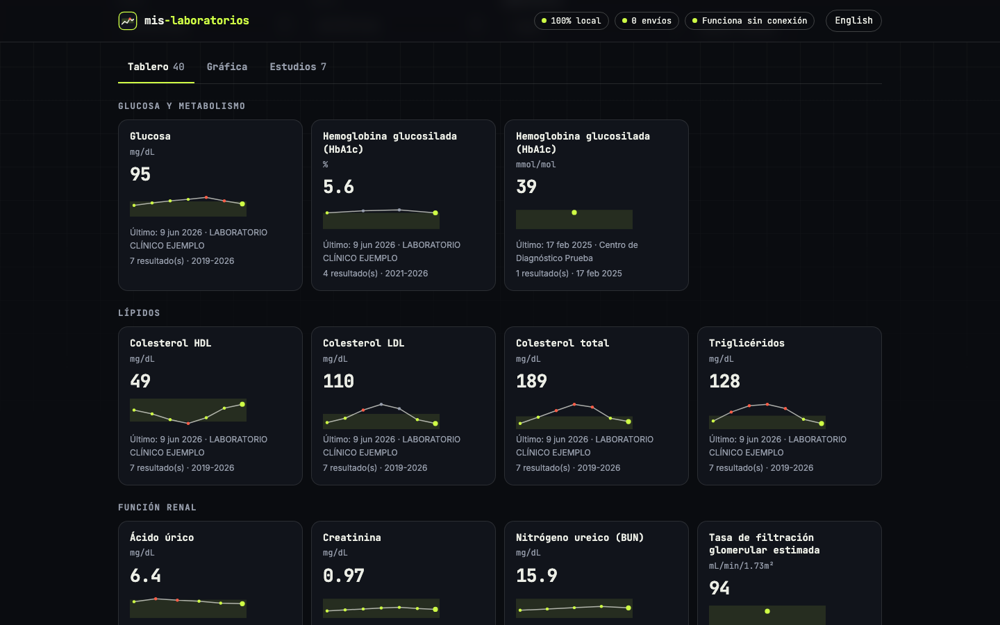
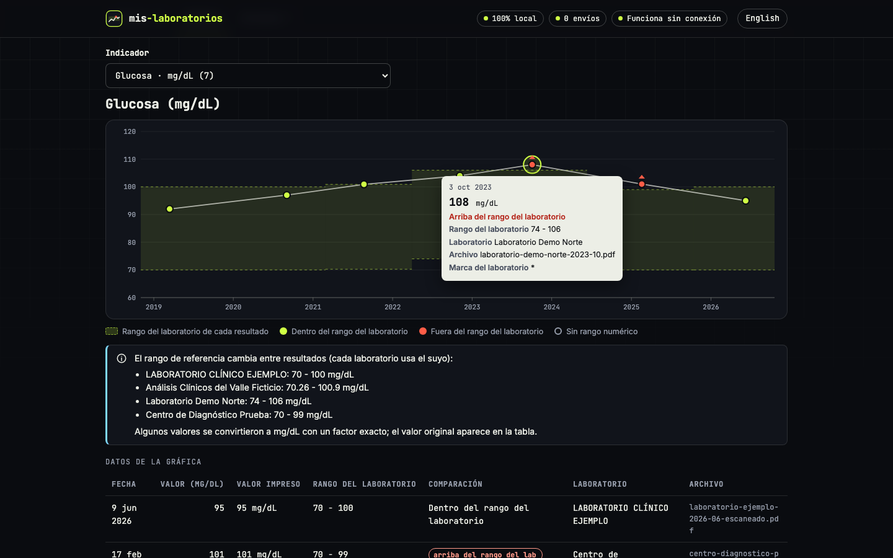
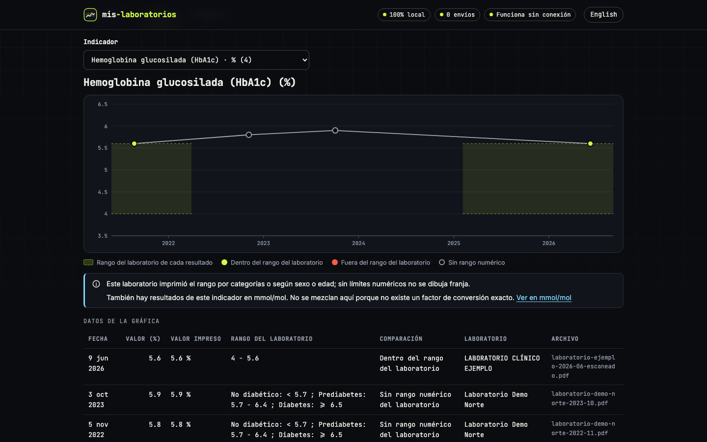
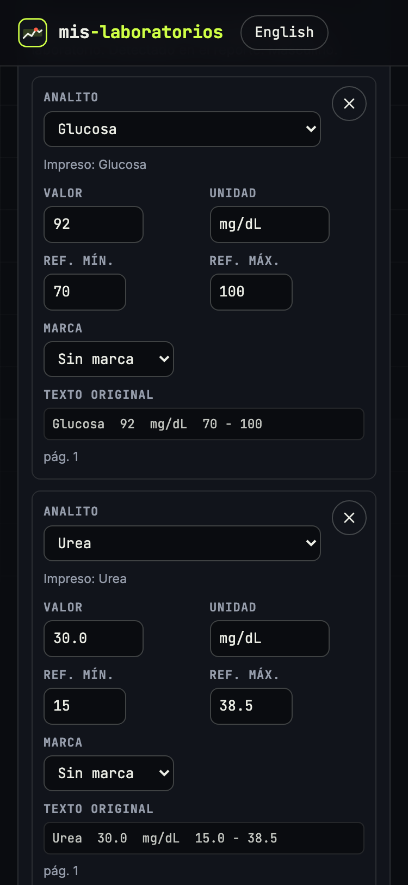
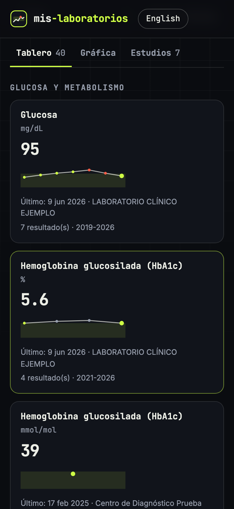
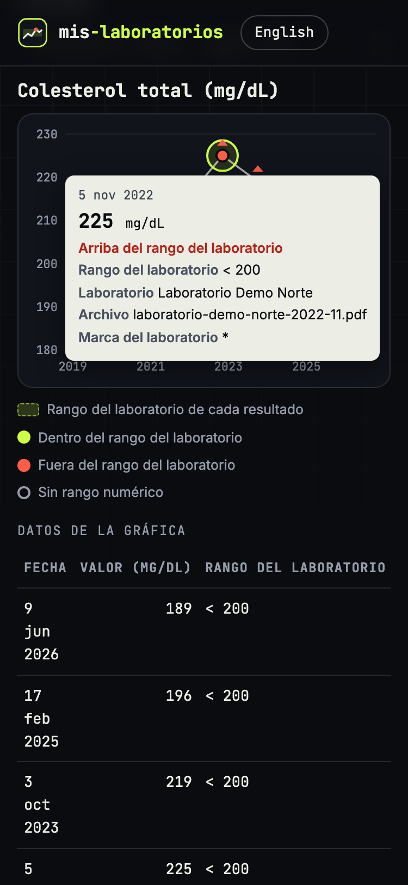
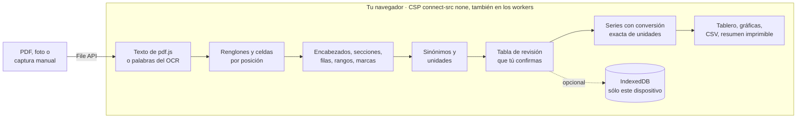

<p align="center">
  
</p>

<p align="center">
  <a href="https://beg-lag.github.io/mis-laboratorios/"><strong>Abrir la app</strong></a> ·
  <a href="README.md">Read in English</a>
</p>

<p align="center">
  <a href="https://github.com/BEG-lag/mis-laboratorios/actions/workflows/ci.yml"></a>
  <a href="https://github.com/BEG-lag/mis-laboratorios/actions/workflows/deploy.yml"></a>
  <a href="LICENSE"></a>
</p>

# mis-laboratorios

Una app web privada por diseño para personas en México. Arrastra los PDF de tus análisis clínicos y,
**todo en tu navegador, sin subir nada**, lee cada analito, te deja confirmar cada valor contra el
texto original y grafica cada indicador a lo largo de los años contra el rango de referencia
**impreso por el laboratorio que emitió cada resultado**.

> **Aviso.** Organiza y grafica tus resultados. No interpreta, no diagnostica y no sustituye a tu
> médico.

Sólo organiza y grafica. Nunca dice si un valor es bueno o malo ni sugiere causas, tratamientos o
pasos a seguir. La única comparación que hace es la objetiva: si un valor queda dentro o fuera del
rango que el mismo laboratorio imprimió junto a él.

## Qué hace

- **Lee PDF con texto** con [pdf.js](https://mozilla.github.io/pdf.js/) (autoalojado, con su worker
  incluido, sin CDN): arrastrar y soltar, selector de archivos o una carpeta completa; reportes de
  varias páginas.
- **OCR opcional** para PDF escaneados y fotos (JPG, PNG, WebP) con
  [tesseract.js](https://github.com/naptha/tesseract.js) y el modelo en español, autoalojados y
  descargados desde este mismo sitio sólo cuando activas el OCR.
- **Extrae** cada renglón de analito (nombre, valor, unidad, rango de referencia y marcas del
  laboratorio como `H`, `L`, `A`, `B`, `*`), la fecha del estudio (primero la de toma de muestra,
  nunca la de nacimiento), el nombre del laboratorio y el sexo y la edad impresos en el reporte
  (sólo para elegir un rango por sexo o edad impreso por el laboratorio).
- **Primero la revisión humana.** Cada valor leído aparece en una tabla editable junto al fragmento
  original y su página. Puedes corregir valores, unidades y límites, cambiar el analito, agregar o
  eliminar filas o descartar el documento. Nada entra a tu historial sin tu confirmación. La captura
  manual funciona igual para valores sin PDF.
- **Normaliza** los nombres con un diccionario de sinónimos de 68 analitos y convierte unidades
  **sólo con factores documentados y exactos**. Los resultados en una unidad sin factor exacto forman
  una serie aparte; nunca se mezclan unidades en silencio.
- **Grafica** cada indicador a lo largo de los años con la franja del rango de **cada** resultado (si
  los laboratorios difieren, la franja cambia y la app lista el rango de cada uno), marcas para los
  valores fuera del rango de su propio laboratorio y detalle al pasar el cursor, enfocar o tocar, con
  fecha, laboratorio, archivo, la marca del laboratorio y cualquier conversión de unidad. Un
  **tablero** muestra todos los indicadores con su minigráfica.
- **Filtra** por fecha y laboratorio. **Exporta** CSV (normal y para Excel) y un **resumen
  imprimible** para llevar a tu médico.
- Interfaz en español con opción en inglés, teclado y lector de pantalla, funciona sin conexión (PWA)
  y en el celular.

## Privacidad

Tus resultados no salen de tu dispositivo, y no es una promesa: está forzado.

- **Sin subidas ni servidor.** Los archivos se leen con la File API y se procesan en el navegador.
- **Una política de seguridad de contenido bloquea la red.** La página de producción lleva
  `default-src 'none'` y `connect-src 'none'`: el navegador rechaza `fetch`, XHR, WebSocket y beacons.
  Los workers de pdf.js y del OCR se crean desde URL `blob:` para que **hereden** esa política: tampoco
  pueden hacer peticiones. El modelo de idioma del OCR se carga como script del mismo origen
  (`importScripts`), no con `fetch`, y tesseract.js no guarda nada en IndexedDB
  (`cacheMethod: 'none'`). `'wasm-unsafe-eval'` se permite sólo para que el OCR compile WebAssembly;
  el `eval` de JavaScript sigue bloqueado.
- **Reglas de lint** prohíben `fetch`, `XMLHttpRequest`, `WebSocket`, `EventSource` y `sendBeacon` en
  el código de la app.
- **Verificado en CI.** Una prueba de Playwright carga seis PDF sintéticos en el build de producción,
  los revisa y confirma, abre gráficas, filtra, exporta CSV, imprime y cambia de idioma, y comprueba
  que hubo **cero peticiones HTTP** después de cargar la página (incluidos workers y service worker).
  Otra prueba demuestra que `fetch` está bloqueado en la página y en un worker `blob:`. La prueba del
  OCR comprueba que las únicas peticiones son `GET` del mismo sitio por los archivos del motor, sin
  cuerpo, y que el OCR funciona sin conexión después de recargar.
- **Sin analítica, cookies ni CDN de terceros.** Las tipografías (JetBrains Mono, Inter, Cormorant
  Garamond) se sirven desde el mismo sitio y se cargan al inicio.
- **Nada se guarda por omisión.** Si lo activas ("Recordar en este dispositivo"), los resultados
  confirmados se guardan sólo en el IndexedDB de este navegador hasta que pulses **Borrar todo**, que
  elimina la base. Los documentos por revisar nunca se guardan.

## Capturas

Todas las capturas usan datos sintéticos: una persona, laboratorios, folios y valores inventados.

| Revisa antes de guardar | Tablero |
|---|---|
|  |  |

| Gráfica con el rango de cada laboratorio | Unidades que no se mezclan |
|---|---|
|  |  |

<p align="center">
  
  
  
</p>

## Cómo funciona



El extractor trabaja con renglones y celdas (bloques de texto separados por espacios horizontales),
así que el mismo código lee PDF con texto y la salida del OCR. Reconoce encabezados de tabla
(`Estudio`, `Prueba`, `Determinación`, `Parámetro`, `Resultado`, `Unidades`, `Valores de referencia`,
`Intervalo`), ignora la columna de resultado anterior, separa tablas lado a lado, une rangos que
continúan en el renglón siguiente y descarta encabezados, pies y firmas. En pruebas locales, Chromium
leyó y analizó los seis PDF sintéticos en unos **35 ms**; el OCR de una página escaneada tardó unos
2 s.

## Formatos que reconoce

No hay plantillas por laboratorio. El extractor maneja rasgos comunes en reportes de laboratorios
grandes de México según material público de ejemplo, reproducidos aquí con fixtures **sintéticos**
([`src/lib/synthetic.ts`](src/lib/synthetic.ts), generados por [`scripts/fixtures.ts`](scripts/fixtures.ts)):

| Maqueta | Qué prueba |
|---|---|
| Clásica de cuatro columnas | `Estudio · Resultado · Unidades · Valores de referencia`, marca en columna propia, rango por sexo en dos renglones (`Hombres:` / `Mujeres:`) |
| Coma decimal, dos páginas | `5,6 mmol/L`, miles con punto (`245.000 /µL`), rango antes de la unidad, marca pegada al valor (`212 H`), `Menor de 200`, `Hasta 150`, `H: 3,4 - 7,0 / M: 2,4 - 5,7`, encabezado repetido en la página 2 |
| Columna de resultado anterior | `Resultado anterior` ignorado, marcas con `*`, rangos por categorías en varios renglones (HbA1c, vitamina D, LDL), fecha escrita con palabras |
| Biometría lado a lado | dos tablas en los mismos renglones, valores alineados a la derecha, columna de marca al final, `x10^9/L`, `g/L`, `L/L`, `µmol/L`, `pmol/L`, `mmol/mol`, `<0.3` |
| Página escaneada y foto | PDF sólo con imagen y JPG leídos con OCR |

Rangos que entiende: `70 - 100`, `70 a 100`, `0,70 - 1,30`, `< 200`, `<= 5.7`, `≤ 5.7`, `Menor de`,
`Hasta`, `Inferior a`, `> 40`, `>= 60`, `Mayor de`, `Mayor o igual a`, `Desde`, unidad dentro del
rango, rangos impresos en dos unidades, etiquetas de sexo (`Hombres/Mujeres`, `Masculino/Femenino`,
`H/M`, `M/F`) y de edad (`Adultos`, `Niños`, `18 - 49 años`).

**Reglas para los rangos.** Sólo se usa el rango del propio laboratorio. Si depende del sexo o la
edad, se elige el que corresponde a lo que dice el reporte (puedes cambiarlo en la revisión). Si el
laboratorio imprime varias categorías (por ejemplo `Deseable`, `Limítrofe`, `Alto` o `Prediabetes`),
la app no elige ninguna: conserva el texto, no dibuja franja y no compara, salvo que captures límites
tú.

## Analitos

68 analitos con nombre en español e inglés y sinónimos como los imprimen los laboratorios:

- **Glucosa y metabolismo:** glucosa, HbA1c, insulina
- **Lípidos:** colesterol total, HDL, LDL (calculado o directo, como nota), VLDL, no HDL,
  triglicéridos, índice aterogénico
- **Función renal:** urea, BUN, creatinina, TFG estimada, ácido úrico
- **Función hepática y enzimas:** TGO/AST, TGP/ALT, GGT, fosfatasa alcalina, bilirrubinas, proteínas
  totales, albúmina, DHL, amilasa, lipasa
- **Biometría hemática:** hemoglobina, hematocrito, eritrocitos, leucocitos, plaquetas, VCM, HCM,
  CMHC, ADE, VPM, VSG y la fórmula leucocitaria en % y en conteo absoluto (decide la unidad)
- **Tiroides:** TSH, T4 libre, T4 total, T3 libre, T3 total
- **Vitaminas y hierro:** vitamina D (25-OH), vitamina B12, ácido fólico, ferritina, hierro
- **Electrolitos y minerales:** sodio, potasio, cloro, calcio, magnesio, fósforo
- **Otros:** PCR, PSA total y libre, testosterona total

Los renglones que claramente son resultados pero no están en el diccionario se conservan con el
nombre impreso y se grafican por separado. Las secciones de orina (`Examen general de orina`) nunca
se mapean a analitos de sangre.

## Conversión de unidades

Exactas por definición (cambio de prefijo en la misma magnitud): `mg/dL`, `g/dL`, `g/L`, `mg/L`,
`µg/dL`, `µg/L`, `ng/mL`, `ng/dL`, `pg/mL`; `mmol/L`, `µmol/L`, `nmol/L`, `pmol/L`; `U/L` y `µkat/L`
(1 µkat/L = 60 U/L); `mUI/L` = `µUI/mL`; conteos por µL y por L (`x10³/µL` = `x10^9/L`,
`x10⁶/µL` = `x10^12/L`, `/µL`, `/mm³`). Propias del analito: `UI/L` = `U/L` en enzimas, `L/L` x 100 =
`%` en hematocrito, `mEq/L` = `mmol/L` en iones monovalentes.

De masa a cantidad de sustancia sólo con la masa molar del compuesto (PubChem); el factor es exacto
dada esa masa molar:

| Analito | Masa molar (g/mol) | Factor |
|---|---|---|
| Glucosa | 180.16 | 1 mmol/L = 18.016 mg/dL |
| Colesterol (total, HDL, LDL, VLDL, no HDL) | 386.65 | 1 mmol/L = 38.665 mg/dL |
| Triglicéridos (trioleína, convención de laboratorio) | 885.43 | 1 mmol/L = 88.543 mg/dL |
| Urea | 60.06 | 1 mmol/L = 6.006 mg/dL |
| BUN (2 x N) | 28.014 | 1 mmol/L = 2.8014 mg/dL |
| Creatinina | 113.12 | 1 µmol/L = 0.011312 mg/dL |
| Ácido úrico | 168.11 | 1 µmol/L = 0.016811 mg/dL |
| Bilirrubina | 584.66 | 1 µmol/L = 0.058466 mg/dL |
| Calcio | 40.078 | 1 mmol/L = 4.0078 mg/dL |
| Hierro | 55.845 | 1 µmol/L = 5.5845 µg/dL |
| T4 libre / total | 776.87 | 1 pmol/L = 0.077687 ng/dL |
| T3 libre / total | 650.97 | 1 pmol/L = 0.65097 pg/mL |
| Vitamina D (25-OH) | 400.64 | 1 nmol/L = 0.40064 ng/mL |
| Vitamina B12 | 1355.37 | 1 pmol/L = 1.3554 pg/mL |
| Ácido fólico | 441.4 | 1 nmol/L = 0.4414 ng/mL |
| Testosterona | 288.42 | 1 nmol/L = 28.842 ng/dL |

**Nunca se convierte:** HbA1c entre `%` y `mmol/mol` (se relacionan con una ecuación de regresión, no
con un factor), insulina entre `µUI/mL` y `pmol/L` (factor convencional), proteínas como albúmina o
ferritina entre masa y unidades molares, ni ninguna unidad que el diccionario no conozca. Se grafican
como series aparte y la gráfica lo indica. Los valores convertidos conservan el original en la tabla,
el detalle y el CSV.

## Limitaciones

- **No es consejo médico.** No interpreta, no diagnostica y no recomienda nada.
- Cada laboratorio imprime distinto. El extractor es heurístico: revisa siempre antes de confirmar.
  Nombres partidos en dos renglones, reportes con varias fechas de toma en un archivo, reportes
  acumulados y formatos muy inusuales pueden requerir correcciones a mano.
- Una sola fecha por documento (la de toma de muestra si viene impresa). El nombre del paciente sólo
  se muestra para que verifiques que el reporte es tuyo; no se usa para separar personas.
- El OCR comete errores (sobre todo en unidades como `x10^3/µL`), es lento con documentos grandes
  (hasta 8 páginas por archivo) y necesita descargar una vez unos 7 MB desde este mismo sitio (unos
  3.6 MB comprimidos). Los PDF escaneados con imágenes JBIG2 o JPEG 2000 pueden no dibujarse sin los
  decodificadores WebAssembly de pdf.js, que no se incluyen. Las fotos HEIC no se leen; expórtalas
  como JPG.
- Los rangos por categorías se conservan como texto y se dibujan sin franja. Los resultados
  cualitativos (`Negativo`) se conservan pero no se grafican.
- Los laboratorios se agrupan por una clave normalizada; el mismo laboratorio escrito muy distinto
  cuenta como dos (puedes editar el nombre en la revisión).
- Los PDF protegidos con contraseña no se pueden leer.

## Correrla en tu computadora

Requiere Node.js 22.18 o posterior (los scripts usan el soporte de TypeScript integrado en Node).

```bash
npm install
npm run dev          # http://localhost:5173/mis-laboratorios/
npm run check        # typecheck + lint + guiones largos + pruebas unitarias + build
npm run test:coverage
npx playwright install chromium
npm run e2e          # construye, sirve y corre las pruebas de punta a punta
npm run fixtures     # regenera los PDF sintéticos de tests/fixtures
npm run screenshots  # regenera docs/screenshots con datos sintéticos
```

Pulsa **Probar con datos de ejemplo** para cargar siete reportes ficticios de 2019 a 2026.

### Pruebas

- **127 pruebas unitarias (Vitest):** formatos de número, unidades y conversiones exactas, cada forma
  de rango, fechas, el diccionario de analitos, el extractor en cada maqueta sintética (en memoria y
  desde PDF reales leídos con pdf.js), OCR del escaneo sintético con tesseract.js, lectura de
  archivos y reporte de errores, la revisión, series, CSV, almacenamiento IndexedDB (fake-indexeddb) e
  i18n, incluida una revisión de que ningún texto de la interfaz use lenguaje de interpretación
  médica. Cobertura de más de 90% de las sentencias en `src/lib`.
- **16 pruebas de Playwright** sobre el build de producción: arrastrar y soltar real, edición y
  validación en la revisión, captura manual, archivos ilegibles, gráficas con teclado y toque, series
  de unidades que no deben mezclarse, filtros, eliminar un estudio, CSV y resumen imprimible, inglés,
  almacenamiento opcional y borrado, modo sin conexión, privacidad del OCR y OCR sin conexión, CSP en
  página y workers, cero peticiones de red, revisión axe WCAG 2.1 A/AA y sin desplazamiento horizontal
  a 375 px.
- Los datos de prueba son **sólo sintéticos**: "Paciente de Ejemplo", laboratorios, folios y valores
  inventados.

### Tamaño

| Parte | Tamaño | Gzip |
|---|---|---|
| JavaScript de la app (incluye pdf.js) | 584 KB | 177 KB |
| Worker de pdf.js | 1.27 MB | 378 KB |
| CSS | 22 KB | 6 KB |
| Tipografías (woff2) | 115 KB | |
| Motor de OCR, sólo si activas el OCR | unos 6.8 MB | unos 3.6 MB |

### Estructura

```
src/lib/      extractor, renglones, rangos, unidades, analitos, fechas, revisión, series, CSV,
              almacenamiento, i18n, adaptadores de pdf.js y OCR, reportes sintéticos
src/ui/       estado y eventos, vistas, gráficas SVG, resumen imprimible, iconos
plugins/      plugins de Vite: CSP, motor de OCR autoalojado, service worker sin dependencias
scripts/      PDF sintéticos, capturas, iconos, revisión de guiones largos
tests/        pruebas unitarias, de punta a punta y fixtures sintéticos
```

## Autor

**Benjamín Esponda García**, abogado en la Ciudad de México que construye con IA.

- Sitio: [pivotek.mx](https://pivotek.mx)
- Portafolio: [github.com/BEG-lag/portafolio-ia](https://github.com/BEG-lag/portafolio-ia)

## Licencia

[MIT](LICENSE). pdf.js y tesseract.js son Apache-2.0; el modelo de OCR en español viene de tessdata
(Apache-2.0); las tipografías vienen de Fontsource con licencia SIL Open Font License.
