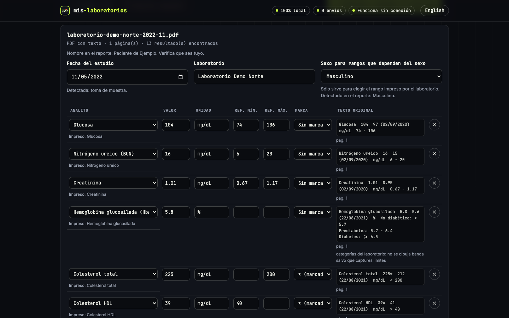
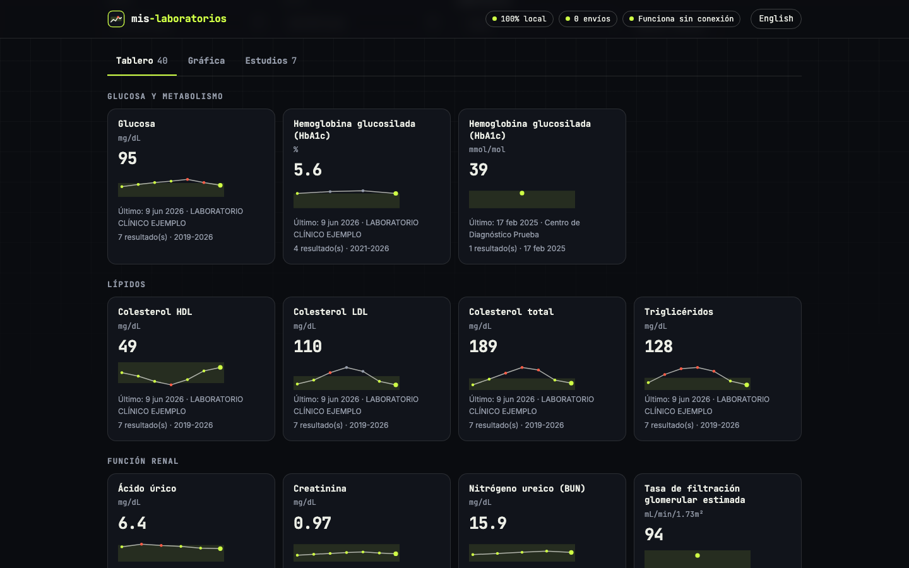
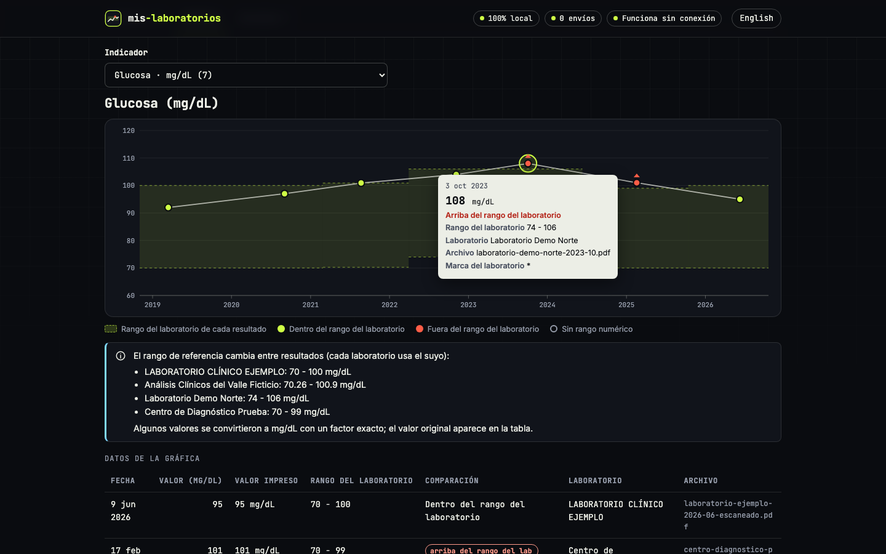
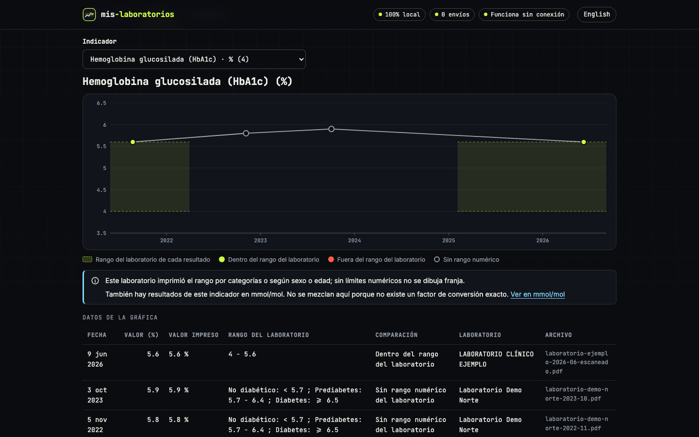
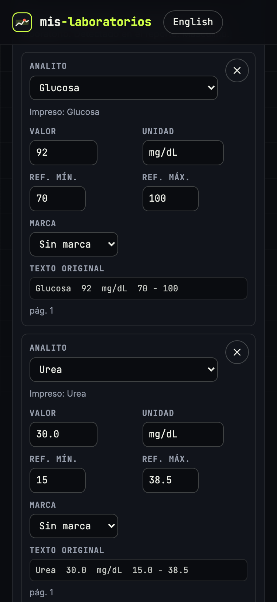
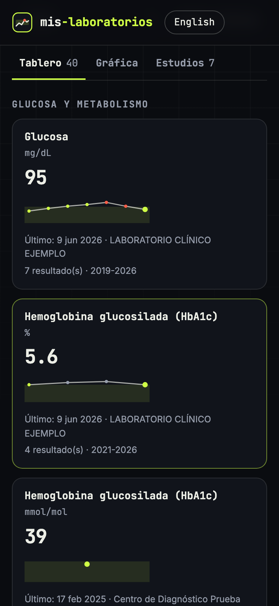
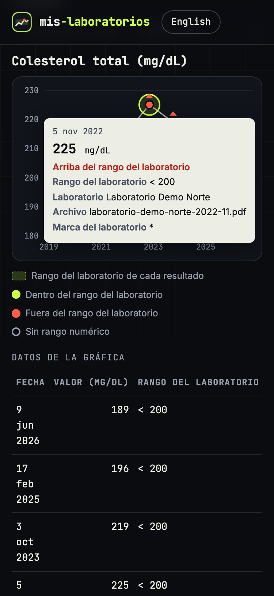
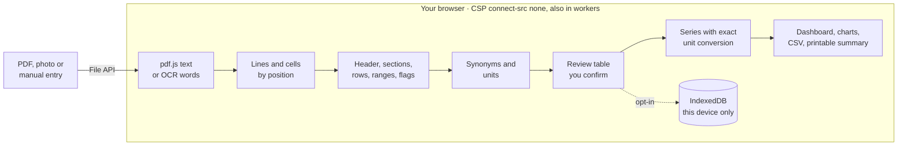

<p align="center">
  <a href="https://pivotek.mx"></a>
</p>

<p align="center">
  
</p>

<p align="center">
  <a href="https://beg-lag.github.io/mis-laboratorios/"><strong>Open the app</strong></a> ·
  <a href="README.es.md">Leer en español</a>
</p>

<p align="center">
  <a href="https://github.com/BEG-lag/mis-laboratorios/actions/workflows/ci.yml"></a>
  <a href="https://github.com/BEG-lag/mis-laboratorios/actions/workflows/deploy.yml"></a>
  <a href="LICENSE"></a>
</p>

# mis-laboratorios

A private-by-design web app for people in Mexico. Drop the PDFs of your clinical lab results and,
**entirely in your browser, with nothing uploaded**, it reads every analyte, lets you confirm each
value against the original text, and charts every indicator over the years against the reference
range **printed by the lab that issued each result**.

> **Disclaimer.** Organiza y grafica tus resultados. No interpreta, no diagnostica y no sustituye a tu
> médico. (Organizes and charts your results. It does not interpret, does not diagnose and does not
> replace your doctor.)

It only organizes and charts. It never says whether a value is good or bad, never suggests a cause,
a treatment or a next step. The only comparison it makes is the factual one: whether a value is
inside or outside the range that the same lab printed next to it.

## What it does

- **Reads text PDFs** with [pdf.js](https://mozilla.github.io/pdf.js/) (self-hosted, worker bundled,
  no CDN): drag and drop, a file picker or a whole folder; multi-page reports.
- **Optional OCR** for scanned PDFs and photos (JPG, PNG, WebP) with
  [tesseract.js](https://github.com/naptha/tesseract.js) and the Spanish model, self-hosted and
  downloaded from the same site only when you switch OCR on.
- **Extracts** each analyte row (name, value, unit, reference range, lab flags such as `H`, `L`, `A`,
  `B`, `*`), the report date (the sample date first, never the date of birth), the lab name, and the
  sex and age printed on the report (used only to pick a sex or age specific range printed by the lab).
- **Human review first.** Every extracted value is shown in an editable table next to the source
  snippet and page number. You can fix values, units and limits, change the analyte, add or delete
  rows, or discard a document. Nothing reaches your history until you confirm. Manual entry works the
  same way for values without a PDF.
- **Normalizes** analyte names with a synonym dictionary of 68 analytes and converts units **only
  with documented, exact factors**. Results in a unit without an exact factor become a separate
  series; units are never mixed silently.
- **Charts** one indicator at a time over the years with the reference band of **each** result (when
  labs differ, the band changes and the app lists each lab's range), markers for values outside that
  result's own lab range, and hover, focus or tap details with date, lab, source file, the lab flag
  and any unit conversion. A **dashboard** shows every indicator with a sparkline.
- **Filters** by date and lab. **Exports** CSV (plain and Excel-friendly) and a **printable summary**
  to take to your doctor.
- Spanish interface with an English toggle, keyboard and screen reader support, works offline (PWA),
  mobile friendly.

## Privacy

Your results never leave your device, and this is enforced, not just promised:

- **No uploads, no backend.** Files are read with the File API and parsed in the browser.
- **A Content Security Policy blocks the network.** The production page ships `default-src 'none'`
  and `connect-src 'none'`, so `fetch`, XHR, WebSocket and beacons are refused. The pdf.js and OCR
  workers are created from `blob:` URLs so they **inherit** that policy: they cannot make requests
  either. The OCR language model is loaded as a same-origin script (`importScripts`), not with
  `fetch`, and tesseract.js is told not to cache anything in IndexedDB (`cacheMethod: 'none'`).
  `'wasm-unsafe-eval'` is allowed only so the OCR engine can compile WebAssembly; JavaScript `eval`
  stays blocked.
- **Lint rules** forbid `fetch`, `XMLHttpRequest`, `WebSocket`, `EventSource` and `sendBeacon` in the
  app code.
- **Verified in CI.** A Playwright test loads six synthetic PDFs into the production build, reviews and
  confirms them, opens charts, filters, exports a CSV, prints and switches language, and asserts that
  **zero HTTP requests** were made after the page was ready (including workers and the service
  worker). Another test proves that `fetch` is blocked both in the page and in a `blob:` worker. The
  OCR test asserts that the only requests are same-origin `GET`s for the OCR engine files, with no
  body, and that OCR still works offline after a reload.
- **No analytics, no cookies, no third-party CDNs.** Fonts (JetBrains Mono, Inter, Cormorant Garamond)
  are self-hosted and loaded at startup.
- **Nothing is stored by default.** If you opt in ("Recordar en este dispositivo"), confirmed results
  are kept only in this browser's IndexedDB until you press **Borrar todo** (delete everything), which
  deletes the database. Documents waiting for review are never stored.

## Screenshots

All screenshots use synthetic data: an invented person, invented labs, invented folio numbers and
invented values.

| Review before saving | Dashboard |
|---|---|
|  |  |

| Chart with each lab's range | Units that cannot be mixed |
|---|---|
|  |  |

<p align="center">
  
  
  
</p>

## How it works



The extractor works on lines and cells (text blocks separated by horizontal gaps), so the same code
reads text PDFs and OCR output. It recognizes table headers (`Estudio`, `Prueba`, `Determinación`,
`Parámetro`, `Resultado`, `Unidades`, `Valores de referencia`, `Intervalo`), skips a "previous result"
column, splits side-by-side tables, joins ranges that continue on the next line, and rejects header,
footer and signature lines. In local runs, Chromium read and parsed the six synthetic text PDFs in
about **35 ms**; OCR of one scanned page took about 2 s.

## Supported layouts

There is no per-lab template. The parser handles patterns common in reports from large Mexican labs
as described in public sample material, reproduced here with **synthetic** fixtures
([`src/lib/synthetic.ts`](src/lib/synthetic.ts), generated by [`scripts/fixtures.ts`](scripts/fixtures.ts)):

| Layout | What it exercises |
|---|---|
| Classic four columns | `Estudio · Resultado · Unidades · Valores de referencia`, flag in its own column, sex-specific range on two lines (`Hombres:` / `Mujeres:`) |
| Decimal comma, two pages | `5,6 mmol/L`, thousands with a dot (`245.000 /µL`), range before unit, flag glued to the value (`212 H`), `Menor de 200`, `Hasta 150`, `H: 3,4 - 7,0 / M: 2,4 - 5,7`, repeated header on page 2 |
| Previous result column | `Resultado anterior` ignored, value flags with `*`, multi-line category ranges (HbA1c, vitamin D, LDL), date written in words |
| Side-by-side CBC | two tables on the same lines, right-aligned values, flag column at the end, `x10^9/L`, `g/L`, `L/L`, `µmol/L`, `pmol/L`, `mmol/mol`, `<0.3` |
| Scanned page and photo | image-only PDF and JPG read with OCR |

Ranges understood: `70 - 100`, `70 a 100`, `0,70 - 1,30`, `< 200`, `<= 5.7`, `≤ 5.7`, `Menor de`,
`Hasta`, `Inferior a`, `> 40`, `>= 60`, `Mayor de`, `Mayor o igual a`, `Desde`, units inside the range,
ranges printed in two units, sex labels (`Hombres/Mujeres`, `Masculino/Femenino`, `H/M`, `M/F`) and age
labels (`Adultos`, `Niños`, `18 - 49 años`).

**Rules for ranges.** Only the lab's own range is used. When the range depends on sex or age, the app
picks the one that matches what the report says (you can change it in the review). When the lab
prints several categories (for example `Deseable`, `Limítrofe`, `Alto`, or `Prediabetes`), the app
does not choose one: it keeps the printed text, draws no band and compares nothing, unless you type
limits yourself.

## Analytes

68 analytes with Spanish and English names and synonyms as printed by labs:

- **Glucose and metabolism:** glucosa, HbA1c, insulina
- **Lipids:** colesterol total, HDL, LDL (calculated or direct, kept as a note), VLDL, no HDL,
  triglicéridos, índice aterogénico
- **Kidney:** urea, BUN, creatinina, TFG estimada, ácido úrico
- **Liver and enzymes:** TGO/AST, TGP/ALT, GGT, fosfatasa alcalina, bilirrubinas, proteínas totales,
  albúmina, DHL, amilasa, lipasa
- **Complete blood count:** hemoglobina, hematocrito, eritrocitos, leucocitos, plaquetas, VCM, HCM,
  CMHC, ADE, VPM, VSG, and the white cell differential in % and absolute counts (chosen by unit)
- **Thyroid:** TSH, T4 libre, T4 total, T3 libre, T3 total
- **Vitamins and iron:** vitamina D (25-OH), vitamina B12, ácido fólico, ferritina, hierro
- **Electrolytes and minerals:** sodio, potasio, cloro, calcio, magnesio, fósforo
- **Other:** PCR, PSA total and libre, testosterona total

Rows that are clearly results but not in the dictionary are kept with the name as printed and
charted on their own. Urine sections (`Examen general de orina`) are never mapped to blood analytes.

## Unit conversions

Exact by definition (prefix changes within the same quantity): `mg/dL`, `g/dL`, `g/L`, `mg/L`,
`µg/dL`, `µg/L`, `ng/mL`, `ng/dL`, `pg/mL`; `mmol/L`, `µmol/L`, `nmol/L`, `pmol/L`; `U/L` and `µkat/L`
(1 µkat/L = 60 U/L); `mUI/L` = `µUI/mL`; cell counts per µL and per L (`x10³/µL` = `x10^9/L`,
`x10⁶/µL` = `x10^12/L`, `/µL`, `/mm³`). Analyte-specific: `UI/L` = `U/L` for enzymes, `L/L` x 100 = `%`
for hematocrit, `mEq/L` = `mmol/L` for monovalent ions.

Mass to amount of substance only with the molar mass of the compound (PubChem), so the factor is
exact given that molar mass:

| Analyte | Molar mass (g/mol) | Factor |
|---|---|---|
| Glucosa | 180.16 | 1 mmol/L = 18.016 mg/dL |
| Colesterol (total, HDL, LDL, VLDL, no HDL) | 386.65 | 1 mmol/L = 38.665 mg/dL |
| Triglicéridos (triolein, lab convention) | 885.43 | 1 mmol/L = 88.543 mg/dL |
| Urea | 60.06 | 1 mmol/L = 6.006 mg/dL |
| BUN (2 x N) | 28.014 | 1 mmol/L = 2.8014 mg/dL |
| Creatinina | 113.12 | 1 µmol/L = 0.011312 mg/dL |
| Ácido úrico | 168.11 | 1 µmol/L = 0.016811 mg/dL |
| Bilirrubina | 584.66 | 1 µmol/L = 0.058466 mg/dL |
| Calcio | 40.078 | 1 mmol/L = 4.0078 mg/dL |
| Hierro | 55.845 | 1 µmol/L = 5.5845 µg/dL |
| T4 libre / total | 776.87 | 1 pmol/L = 0.077687 ng/dL |
| T3 libre / total | 650.97 | 1 pmol/L = 0.65097 pg/mL |
| Vitamina D (25-OH) | 400.64 | 1 nmol/L = 0.40064 ng/mL |
| Vitamina B12 | 1355.37 | 1 pmol/L = 1.3554 pg/mL |
| Ácido fólico | 441.4 | 1 nmol/L = 0.4414 ng/mL |
| Testosterona | 288.42 | 1 nmol/L = 28.842 ng/dL |

**Never converted:** HbA1c `%` and `mmol/mol` (related by a regression equation, not a factor),
insulin `µUI/mL` and `pmol/L` (conventional factor), proteins such as albumin or ferritin between
mass and molar units, and any unit the dictionary does not know. These are charted as separate
series and the chart says so. Converted values keep the original in the table, the tooltip and the
CSV.

## Limitations

- **Not medical advice.** It does not interpret, diagnose or recommend anything.
- Every lab prints differently. The parser is heuristic: always review before confirming. Names that
  wrap onto two lines, reports with several sample dates in one file, cumulative reports and very
  unusual layouts may need manual fixes.
- Only one date per document (the sample date when printed). Patient name is shown only so you can
  check the report is yours; it is not used to separate people.
- OCR makes mistakes (especially units such as `x10^3/µL`), is slow on large documents (up to 8 pages
  per file), and needs about 7 MB downloaded once from this same site (about 3.6 MB compressed).
  Scanned PDFs whose images use JBIG2 or JPEG 2000 compression may not render without the pdf.js
  WebAssembly decoders, which are not shipped. HEIC photos are not supported; export them as JPG.
- Ranges by category are kept as text and drawn without a band. Qualitative results (`Negativo`) are
  kept but not charted.
- Lab names are grouped by a normalized key; the same lab spelled very differently counts as two labs
  (you can edit the name in the review).
- Password-protected PDFs cannot be read.

## Run it locally

Requires Node.js 22.18 or newer (the scripts use Node's built-in TypeScript support).

```bash
npm install
npm run dev          # http://localhost:5173/mis-laboratorios/
npm run check        # typecheck + lint + em-dash check + unit tests + build
npm run test:coverage
npx playwright install chromium
npm run e2e          # builds, serves and runs the end-to-end tests
npm run fixtures     # regenerates the synthetic PDFs in tests/fixtures
npm run screenshots  # regenerates docs/screenshots with synthetic data
```

Click **Probar con datos de ejemplo** (try with sample data) to load seven fictitious reports from
2019 to 2026.

### Tests

- **127 Vitest** unit tests: number formats, units and exact conversions, every range form, dates,
  the analyte dictionary, the extractor on every synthetic layout (in memory and from real PDFs read
  with pdf.js), OCR of the synthetic scan with tesseract.js, file ingestion and error reporting, the
  review step, series, CSV, IndexedDB storage (fake-indexeddb) and i18n, including a check that no UI
  string uses interpretive medical wording. Coverage above 90% of statements in `src/lib`.
- **16 Playwright** end-to-end tests on the production build: real drag and drop, review edits and
  validation, manual entry, unreadable files, charts with keyboard and tap, unit series that must not
  mix, filters, deleting a report, CSV and printable summary, English, opt-in storage and delete,
  offline mode, OCR privacy and offline OCR, CSP in page and workers, zero network requests, axe
  WCAG 2.1 A/AA checks, and no horizontal scroll at 375 px.
- Test data is **synthetic only**: "Paciente de Ejemplo", invented labs, folio numbers and values.

### Bundle

| Part | Size | Gzip |
|---|---|---|
| App JavaScript (includes pdf.js) | 584 KB | 177 KB |
| pdf.js worker | 1.27 MB | 378 KB |
| CSS | 22 KB | 6 KB |
| Fonts (woff2) | 115 KB | |
| OCR engine, only when OCR is switched on | about 6.8 MB | about 3.6 MB |

### Project structure

```
src/lib/      extractor, layout, ranges, units, analytes, dates, review, series, CSV, storage, i18n,
              pdf.js and OCR adapters, synthetic reports
src/ui/       app state and events, views, SVG charts, printable summary, icons
plugins/      Vite plugins: CSP, self-hosted OCR engine, dependency-free service worker
scripts/      synthetic PDF fixtures, screenshots, icons, em-dash check
tests/        unit tests, end-to-end tests and synthetic fixtures
```

## Author

**Benjamín Esponda García**, a lawyer in Mexico City who builds with AI.

- Site: [pivotek.mx](https://pivotek.mx)
- Portfolio: [github.com/BEG-lag/portafolio-ia](https://github.com/BEG-lag/portafolio-ia)

## License

[MIT](LICENSE). pdf.js and tesseract.js are Apache-2.0; the Spanish OCR model comes from
tessdata (Apache-2.0); fonts are bundled from Fontsource under the SIL Open Font License.
